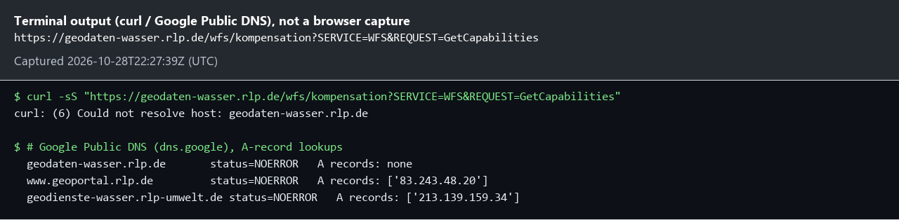
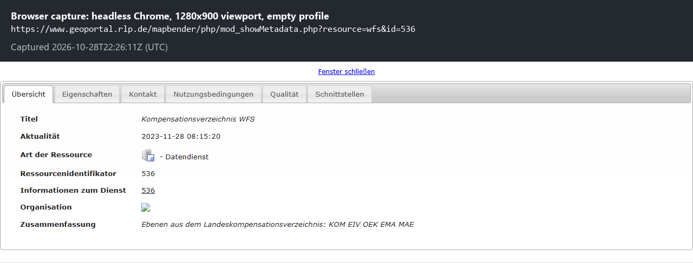
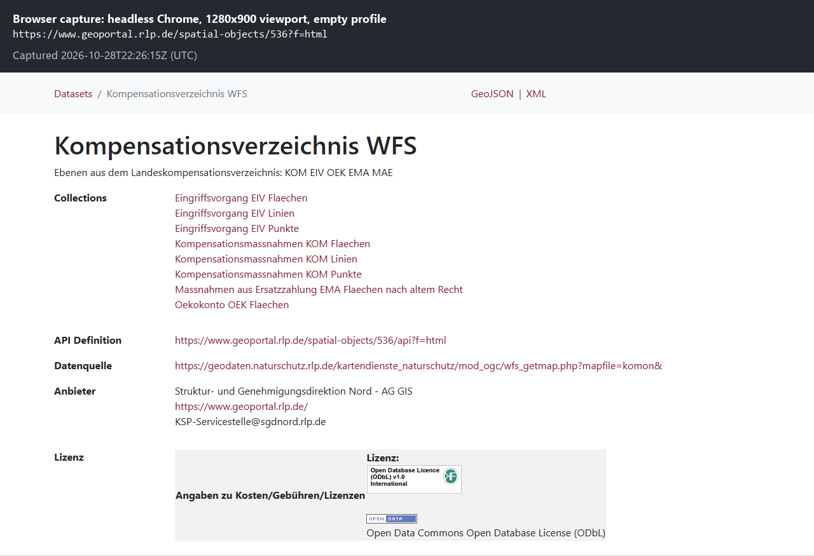
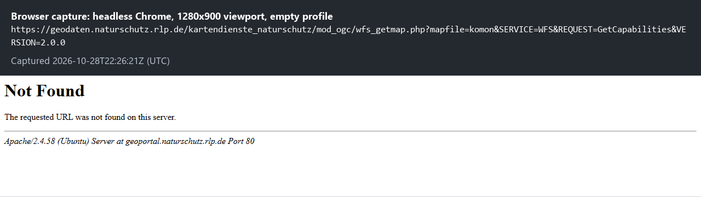
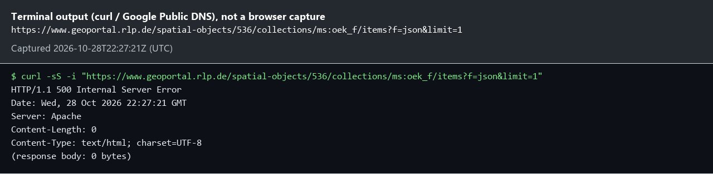
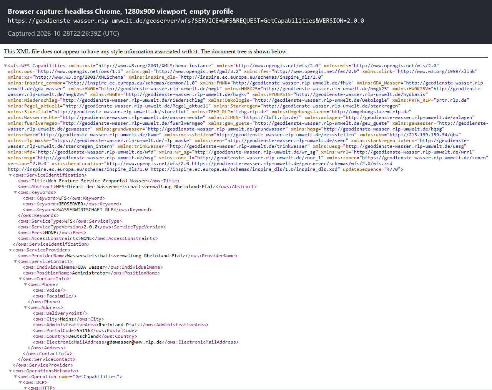
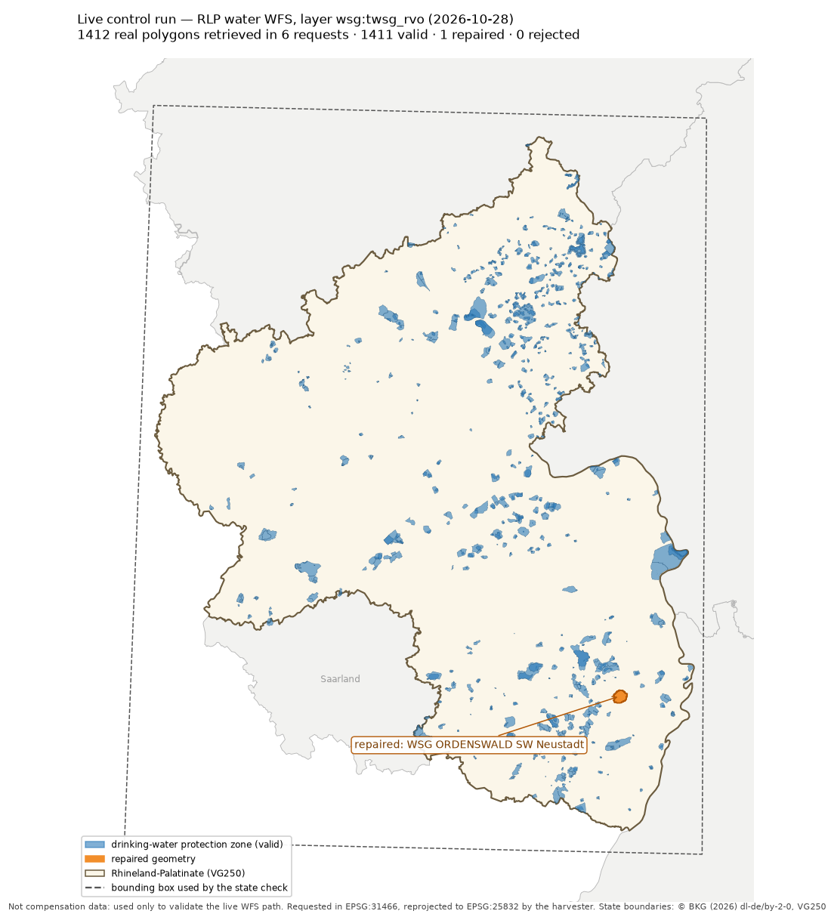
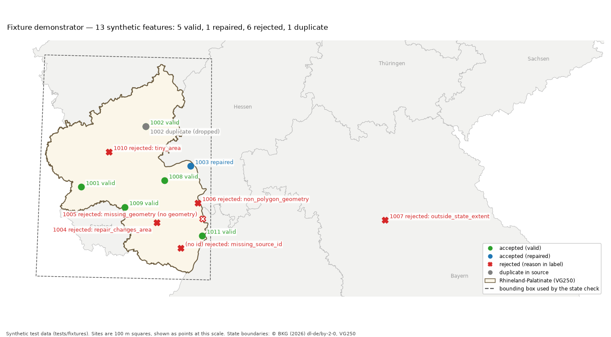

# Source discovery — 2026-10-27

The brief asked for the WFS capabilities, layer names, permissions and schema to be checked before use. This is what those checks found. Raw outputs are in `docs/evidence/`; screenshots and maps are in [§7](#7-visual-evidence).

## 1. Endpoint and layer named in the brief

| Brief | Result |
|---|---|
| `https://geodaten-wasser.rlp.de/wfs/kompensation` | Host has **no DNS address record** (`getaddrinfo failed`; `nslookup` against the local resolver and 8.8.8.8 returns the name without an address). Evidence: `evidence/brief_endpoint_discover_2026-10-27.json`. |
| Layer `rp_oekokonto` | Not advertised by any RLP WFS found in the state geoportal catalogue. |

## 2. Service actually registered for RLP compensation/eco-account data

The RLP geoportal catalogue (`geoportal.rlp.de`, search API `mod_callMetadata.php`, keyword "Kompensation", resource type `wfs`) lists one matching service:

| Field | Value |
|---|---|
| Service | **Kompensationsverzeichnis WFS**, geoportal id 536 |
| Abstract | "Ebenen aus dem Landeskompensationsverzeichnis: KOM EIV OEK EMA MAE" |
| Responsible | Struktur- und Genehmigungsdirektion Nord – LANIS-Zentrale (technical contact: KSP-Servicestelle, SGD Nord, Koblenz) |
| Licence | Open Data Commons Open Database License (ODbL 1.0) |
| Registered URL | `https://geodaten.naturschutz.rlp.de/kartendienste_naturschutz/mod_ogc/wfs_getmap.php?mapfile=komon` (MapServer) |
| Feature types | `ms:eiv_f/l/p` (Eingriffe), `ms:kom_f/l/p` (Kompensationsmaßnahmen), `ms:ema_f` (Ersatzzahlung), **`ms:oek_f` — "Oekokonto OEK Flaechen"** (geoportal feature type id 3008) |
| CRS advertised for `ms:oek_f` | EPSG **31466** (DHDN / GK zone 2), 31467 (GK zone 3), 3857, 4326. **EPSG:25832 is not offered**, so the harvester must reproject. |
| WGS84 extent | 6.0597, 48.9344 – 8.5129, 50.9475 |
| Registry status | last capabilities update 2023-11-28 (1064 days before this check); monitored availability 88.17 % |

`ms:oek_f` is the eco-account layer, so it is the correct match for the brief's domain ("registered offsetting sites"). The harvester is configured for it.

A newer dataset record, **"Ökokonten OEK"** (uuid `d8c45a2a-5bd0-5c66-94e3-1fbc7f262ed9`, dated 2026-09-17, ODbL, daily update, period 2012-07-01 to today), points only to the KSP web application `https://ksp.naturschutz.rlp.de`. It names no download service.

## 3. Access test

| Request | Result |
|---|---|
| Registered URL `…?mapfile=komon&SERVICE=WFS&REQUEST=GetCapabilities&VERSION=2.0.0` | `301` → `https://geoportal.naturschutz.rlp.de/kartendienste_naturschutz/mod_ogc/wfs_getmap.php?...` → **HTTP 404** (Apache). Evidence: `evidence/live_discover_2026-10-27.json`. |
| Geoportal proxy `https://www.geoportal.rlp.de/registry/wfs/536?REQUEST=GetCapabilities` | Routed through the geoportal's `http_auth` gateway; returns `<error>http_auth/index.php: Cannot parse Metadata XML!</error>`. The catalogue marks the service `hasConstraints: true`. |
| WMS of the same register (geoportal id 3082, updated 2026-09-17) | Registered at the same `geodaten.naturschutz.rlp.de` origin, so it lands on the same 404. |
| Geoportal **OGC API – Features** proxy `https://www.geoportal.rlp.de/spatial-objects/536` (labelled "experimental"; checked 2026-10-28) | Service and collection listings work (HTTP 200) and list all 8 layers, including `ms:oek_f`. Every request for a layer's details or **features returns HTTP 500 with an empty body**: `ms:oek_f/items?f=json&limit=1` and `ms:kom_f/items` alike, from the candidate's network and from an independent server. The proxy's own description names the dead origin as its source (`"accessUrl": "https://geodaten.naturschutz.rlp.de/...?mapfile=komon&"`), so it fails for the same reason. Evidence: `evidence/ogcapi_spatial_objects_536_2026-10-28.txt`, `evidence/ogcapi_536_collections_2026-10-28.json`. |
| Every request documented in that API's OpenAPI description (`/spatial-objects/536/api`, OpenAPI 3.0.1), for `ms:oek_f` | `resultType=hits`, `f=html` and a `bbox` filter all return **HTTP 500, empty**. `/items/{id}` returns HTTP 200 but only an **empty shell** (title and links, no geometry, no properties), identically for real-looking ids (`1`, `2`, `100`) and an invented one (`oek_f.1`). `/items/1?f=xml` passes through the origin's own Apache **"404 Not Found"** page. `/conformance`, although listed in the description, answers "URI not valid!". Evidence: `evidence/ogcapi_536_api_checks_2026-10-28.txt`, `evidence/ogcapi_536_openapi_2026-10-28.json`. |

The geoportal's address without `www` (`https://geoportal.rlp.de/`) fails with a TLS certificate name mismatch; use `https://www.geoportal.rlp.de/`.

**Conclusion.** There is no working, openly published WFS or OGC API endpoint for the RLP eco-account layer today. In line with the brief ("do not bypass restrictions"), the harvester does not try undocumented URLs, the authenticated proxy or the KSP web app. Instead:

* The live code path is fully implemented and configured for the registered endpoint and layer. `oek-harvester discover --config config.example.toml` reports the 404 and makes no further requests.
* A fixture-based demonstrator exercises the same discovery, paging, parsing and loading code. Where the real service could be checked, the fixtures copy it (layer names, CRS list, licence, provider, MapServer-style WFS 2.0 responses with northing-first coordinates for the GK URN).

## 4. Other servers checked, and a live control run

To show which servers do respond, and to test the live code path somewhere real, other RLP and German sources were checked on 2026-10-28:

| Source | Result |
|---|---|
| Other LANIS WFS (Schutzgebiete 658, Biotopkartierung 537, Nationalpark 303, WFS Lanis GDI-DE 535) | All registered on the same `geodaten.naturschutz.rlp.de` origin, so the whole LANIS family is unavailable, not only the compensation register. |
| RLP water administration GeoServer `https://geodienste-wasser.rlp-umwelt.de/geoserver/wfs` (geoportal WFS 655; its name resembles the brief's `geodaten-wasser.rlp.de`) | **Works.** WFS 2.0, Fees NONE, AccessConstraints NONE, `ImplementsResultPaging` TRUE, 96 feature types. **No compensation or eco-account layer**; the only "Oeko…" layers are bathing waters and WFD ecological status. |
| Sachsen-Anhalt Kompensationsverzeichnis (LAU) | Its catalogue record restricts access to nature conservation authorities, and it is another state, which the brief excludes. Not used. |

So **no openly available source of RLP compensation data exists today**.

**Live control run.** To validate the live path against a real server, the unchanged harvester was pointed at a real RLP polygon layer on the working water GeoServer: `wsg:twsg_rvo`, drinking-water protection zones (CC BY 4.0). It uses `config.live-control.toml` and runs with `--no-db`. This is **not compensation data** and is never loaded into `compensation_sites`; it only proves that the network, discovery, paging, parsing and geometry code works in production conditions. EPSG:31466 (Gauss-Krüger, northing first) was requested on purpose, so the axis-order handling ran against a real server.

| Brief requirement | Live result |
|---|---|
| Discover the advertised feature type and pagination options | Layer found; `ImplementsResultPaging` TRUE; `numberMatched` 1412; real DescribeFeatureType read (`ID`, `WSG_NR`, `WSG_BEZ`, … `GEOMETRIE`) |
| Retrieve polygons and source identifiers with controlled requests | **6 requests in total** (capabilities, schema, hits, 3 pages of 500), 1 s apart; 1412 polygons with their `ID` |
| Geometry validation and repair | 1411 valid, **1 repaired** (`WSG ORDENSWALD SW Neustadt`, "Ring Self-intersection", within the 1 % area guard), 0 rejected, 0 duplicates |
| Correct projection, including axis order | Compared with the same server's native EPSG:25832 output for 8 zones: centroid shift 0.61–1.31 m, area difference 0.0002 %. That is consistent with the ~3 m Helmert transformation used locally; a swapped axis would have been thousands of kilometres off. All 1412 zones fall inside 6.37–8.51 E / 49.01–50.92 N. |

Reproduce with:

```bash
oek-harvester harvest --config config.live-control.toml --no-db
python scripts/live_control_compare.py output/live-control/sample_sites_25832.gpkg
```

Evidence: `evidence/live_control_water_2026-10-28/` (run report, quality report, issues, native-CRS comparison).

This run also exposed a defect, now fixed: a missing status was flagged on every site even when no status field was configured (1412 warnings). Status is now `unknown` without per-site warnings unless the status field is mapped.

## 5. What could not be verified

* **The attribute schema of `ms:oek_f`.** DescribeFeatureType is unreachable and the geoportal does not store it. The OGC API's OpenAPI description does not fill the gap: its feature schema is generic GeoJSON (`type`, `id`, `geometry` of type Polygon/MultiPolygon/…, and `properties` declared only as `{"type": "object", "nullable": true}`), with no attribute names for any layer. Its examples are the OGC template's "Buildings in the city of Bonn", and the response descriptions of `/items` and `/items/{featureId}` are swapped, so it is an auto-generated description, not a data model. The fixture schema (`oek_id`, `gemeinde`, `status`, `oekopunkte_*`, …) is **synthetic**. The live config therefore maps no attributes: every source attribute is kept verbatim in `source_attributes` until the real schema has been checked.
* The service's real status vocabulary, area units and credit (Ökopunkte) fields.
* Whether MapServer's `gml:id` values for this layer come from a stable database key. The harvester prefers a configured identifier attribute and falls back to `gml:id`.
* Paging support (`ImplementsResultPaging`) and `CountDefault` on the live service. The harvester reads both from capabilities and also handles services without paging. Paging itself was verified live on another RLP server (§4).

## 6. How to unblock live access

If SGD Nord restores the origin, the OGC API proxy above (GeoJSON, `limit` restricted to 1, 5, 10, 20, 50, 100, 200, 500, 1000–4000) would likely work again and could be added as a second transport. The WFS path below remains the primary one.

Ask the KSP-Servicestelle (SGD Nord) for the current WFS URL of the Kompensationsverzeichnis, or for access to the protected geoportal proxy. Then:

```bash
oek-harvester discover --config config.toml     # verify layer, CRS, paging, schema
# fill [mapping.fields] and [mapping.status_values] from the discovered schema
oek-harvester harvest --config config.toml
```

## 7. Visual evidence

Screenshots for quick reading; the raw files above remain the detailed proof. Each image has a caption band with the exact URL and capture time (UTC).

* **Browser captures** were taken with headless Chrome (1280×900 viewport, empty temporary profile, so no cookies or logins).
* **Terminal output.** Browsers do not capture their own error pages, so the DNS failure and the empty HTTP 500 response are shown as `curl` / Google Public DNS output instead, and labelled as such.

| # | Image | What it shows | Supports |
|---|---|---|---|
| 1 | [01_brief_endpoint.png](evidence/screenshots/01_brief_endpoint.png) | `geodaten-wasser.rlp.de` cannot be resolved. Google Public DNS returns **no A record** for it, while `www.geoportal.rlp.de` and `geodienste-wasser.rlp-umwelt.de` resolve. | §1 |
| 2 | [02_geoportal_wfs_536.png](evidence/screenshots/02_geoportal_wfs_536.png) | Geoportal metadata of the registered service: "Kompensationsverzeichnis WFS", id 536, layers "KOM EIV OEK EMA MAE" | §2 |
| 3 | [03_ogcapi_536_collections.png](evidence/screenshots/03_ogcapi_536_collections.png) | Geoportal OGC API page: the 8 layers including **Oekokonto OEK Flaechen**, ODbL licence, provider SGD Nord, and **Datenquelle** = the `geodaten.naturschutz.rlp.de` origin | §2, §3 |
| 4 | [04_registered_wfs_404.png](evidence/screenshots/04_registered_wfs_404.png) | The registered WFS URL redirects to `geoportal.naturschutz.rlp.de`, which answers **404 Not Found** | §3 |
| 5 | [05_ogcapi_oek_items_500.png](evidence/screenshots/05_ogcapi_oek_items_500.png) | Feature request for `ms:oek_f` through the OGC API: **HTTP 500, 0-byte body** | §3 |
| 6 | [06_water_geoserver_ok.png](evidence/screenshots/06_water_geoserver_ok.png) | The working RLP water GeoServer used for the live control run: WFS 2.0 capabilities, Fees NONE, AccessConstraints NONE | §4 |








### Maps

Both maps are regenerated by [`evidence/maps/make_maps.py`](evidence/maps/make_maps.py) (needs matplotlib and network access). They are drawn in EPSG:25832 over the official BKG VG250 state boundaries (© BKG (2026) dl-de/by-2-0).

**Live control run.** All 1,412 real polygons fall inside the official Rhineland-Palatinate outline after reprojection from Gauss-Krüger. The one repaired geometry is highlighted.



**Fixture demonstrator.** The outcome of each of the 13 synthetic features. The Bavarian feature (1007) is visibly outside the state; 1005 has no geometry and is shown at its test-spec position.


